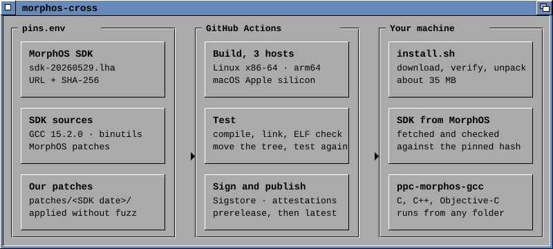

# morphos-cross

**A GCC 15 cross compiler for MorphOS that you install with one command.**

[](https://github.com/metaneutrons/morphos-cross/actions/workflows/ci.yml)
[](https://github.com/metaneutrons/morphos-cross/releases/latest)
[](LICENSE)

<p align="center">
  
</p>

morphos-cross builds `ppc-morphos-gcc`, `ppc-morphos-g++` and the matching binutils for
[MorphOS](https://www.morphos-team.net/) on your Linux or Mac, from the sources the MorphOS Team
publishes with each SDK. Every SDK gets its own release, built by GitHub Actions, tested, signed and
attested. You download about 35 MB, the installer adds the MorphOS headers and libraries from the
MorphOS Team, and the compiler works from whatever folder you put it in.

This is an unofficial project. It is not affiliated with the MorphOS Team.

## Install

```sh
curl -fsSL https://github.com/metaneutrons/morphos-cross/releases/latest/download/install.sh | sh
```

The installer picks the archive for your machine, checks it against `SHA256SUMS` and, when
[cosign](https://docs.sigstore.dev/cosign/system_config/installation/) is installed, against the
Sigstore signature. It unpacks into `~/.morphos-cross/<release>` and points `~/.morphos-cross/current`
at it. Then it downloads the MorphOS SDK from morphos-team.net (about 390 MB), checks it against the
hash pinned in this repository and installs its headers and libraries into the toolchain.

Add the toolchain to your `PATH`:

```sh
export PATH="$HOME/.morphos-cross/current/bin:$PATH"
```

| Option | Effect |
| --- | --- |
| `--version vYYYYMMDD-rN` | install a specific release instead of the latest |
| `--prefix DIR` | install somewhere else (or set `MORPHOS_CROSS_HOME`) |
| `--no-sdk` | skip the SDK; later run `morphos-cross-sdk install` |
| `--require-signature` | stop unless cosign verified the signature |

Pass options to a piped installer with `sh -s --`, for example `... | sh -s -- --no-sdk`.

### Supported machines

| Host | Archive | Requirements |
| --- | --- | --- |
| Linux x86-64 | `linux-x86_64` | glibc 2.36 or newer (tested: Debian 12, Ubuntu 24.04), `curl`, `xz`, and `bsdtar` (package `libarchive-tools`) or `lha` |
| Linux arm64 | `linux-arm64` | the same |
| macOS Apple silicon | `macos-arm64` | macOS 13 or newer; nothing to install |

Ubuntu 22.04 has glibc 2.35 and is not supported.

## Use it

```c
/* hello.c */
#include <stdio.h>

int main(void)
{
    puts("Hello from MorphOS");
    return 0;
}
```

```cpp
// hello.cpp
#include <iostream>

int main()
{
    std::cout << "Hello from MorphOS\n";
    return 0;
}
```

```sh
ppc-morphos-gcc -O2 -o hello hello.c       # ixemul, the default C library
ppc-morphos-gcc -O2 -mclib=libnix -o hello-libnix hello.c
ppc-morphos-g++ -O2 -o hello-cpp hello.cpp
```

The output is a 32-bit big-endian PowerPC ELF executable for MorphOS. Copy it to a MorphOS machine to
run it. The compiler, assembler and linker are the MorphOS Team's own patched GCC 15.2.0 and
binutils 2.45.1, with C, C++, Objective-C and Objective-C++.

In a Makefile:

```make
CC  = ppc-morphos-gcc
CXX = ppc-morphos-g++
AR  = ppc-morphos-ar
```

`morphos-cross-sdk status` tells you whether the SDK is installed in the toolchain you run it from.

## Verify a download

Every asset of a release is listed in `SHA256SUMS`, carries a keyless
[Sigstore](https://www.sigstore.dev/) signature made by this repository's release workflow, and has a
GitHub build provenance attestation.

```sh
tag=v20260529-r2                       # the release you downloaded
asset=morphos-cross-${tag#v}-linux-arm64.tar.xz

sha256sum --check --ignore-missing SHA256SUMS

cosign verify-blob \
  --bundle "$asset.sigstore.json" \
  --certificate-oidc-issuer https://token.actions.githubusercontent.com \
  --certificate-identity "https://github.com/metaneutrons/morphos-cross/.github/workflows/release.yml@refs/heads/main" \
  "$asset"

gh attestation verify "$asset" --repo metaneutrons/morphos-cross
```

## Versions

There is no version number of its own. A release is named after the SDK it was built from:

```
v20260529-r2   =   MorphOS 3.20 SDK of 29 May 2026, second build
```

`-rN` counts rebuilds of the same SDK, for a fix in the scripts or patches. The SDK date, the SHA-256
of the SDK and of its sources and the versions of the components are pinned in
[`pins.env`](pins.env). A merge to `main` that changes `pins.env` releases the new version when its tag
does not exist yet. There is no release pull request.

## The MorphOS SDK

The SDK belongs to the MorphOS Team. Its readme says the system includes may not be distributed
separately without the team's permission, so **no release archive contains any file of the SDK**: a
check in the release pipeline compares every file of the archive with the SDK by name and by content.
The installer fetches the SDK from morphos-team.net instead and verifies it against the hash pinned
here. The compiler itself is built against that SDK.

## How it is built

- **Pinned inputs.** The SDK and its sources are downloaded from morphos-team.net by URL and checked
  against the SHA-256 in `pins.env`. If the files change upstream, the build stops.
- **The MorphOS Team's patches, then ours.** GCC 15.2.0 and binutils 2.45.1 get the patches from the
  SDK sources in the order of the MorphOS Team's own makefile, plus the one it leaves out for cross
  builds. Our patches in [`patches/`](patches/) come after, are applied without fuzz and say why they
  exist. The only one so far replaces the fixed `/gg` in the compiler's search paths with the
  sysroot, which is why the compiler finds the SDK next to itself wherever you put it.
- **A new SDK fails early.** `make patches-check` unpacks the sources and applies every patch in
  about a minute, so a patch that no longer fits shows up before a 30-minute build.
- **Tested the way you use it.** Each archive is unpacked into an empty folder, the SDK is installed
  with the helper from the archive, C and C++ programs are compiled and linked with both C libraries,
  the output is checked to be 32-bit big-endian PowerPC, and then the whole tree is moved and tested
  again. Linux archives are tested once more in fresh Debian 12 and Ubuntu 24.04 containers.
- **No hidden dependencies.** A check fails the build when a program in the archive links anything
  beyond the base system libraries (so no Homebrew library, no distribution package) or needs a newer
  glibc or macOS than the baseline above.

## Licence

The scripts, workflows and patches of this repository are
[GPL-3.0-or-later](LICENSE). The archives contain GCC and binutils (GPL-3.0-or-later; the GCC runtime
libraries carry the
[GCC Runtime Library Exception](https://www.gnu.org/licenses/gcc-exception-3.1.html)) and GMP, MPFR and
MPC (LGPL-3.0-or-later), see [THIRD-PARTY.md](THIRD-PARTY.md). Every release carries the corresponding
source as `morphos-cross-<version>-source.tar.xz`.

## Development

```sh
make setup          # install the git hooks (needs lefthook and gitleaks)
make check          # lint, gates, secret scan: what CI runs besides the builds
scripts/ci-build.sh # build, package and test for this machine (long)
scripts/docker-build.sh # the same for Linux, in the pinned build container
```

See [CONTRIBUTING.md](CONTRIBUTING.md) and [SECURITY.md](SECURITY.md).
